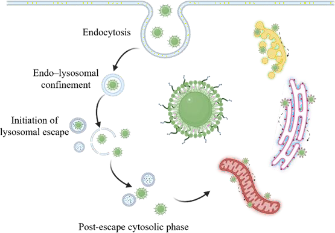
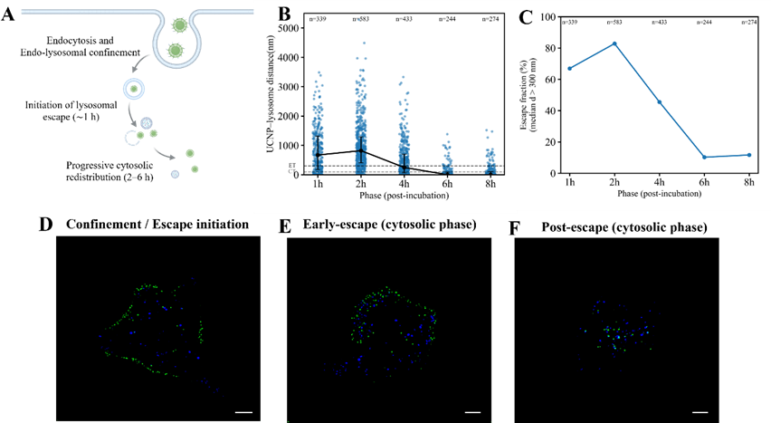
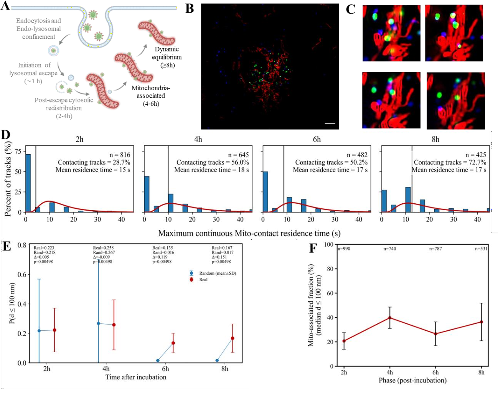
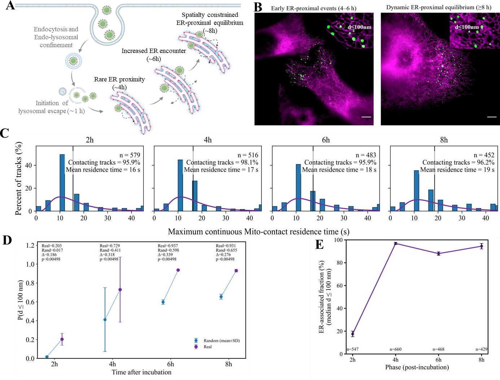
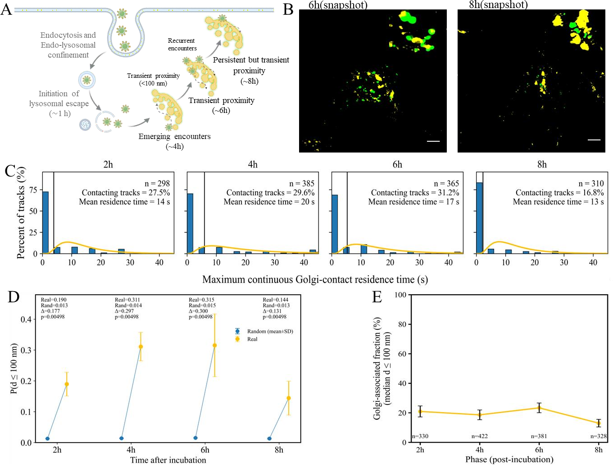
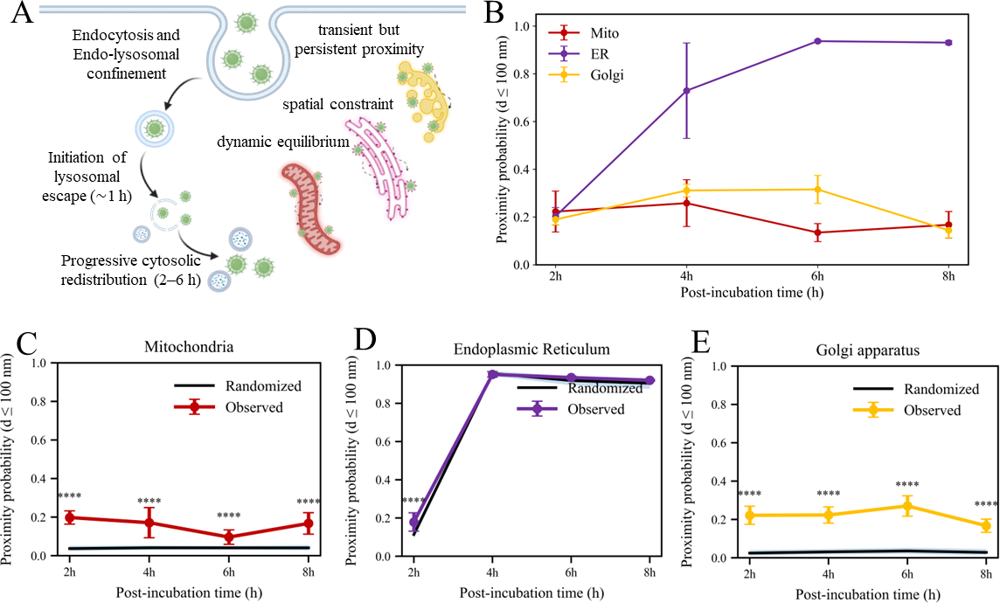

# Spatiotemporal Organelle Interactions of Biomimetic UCNPs

**Experimental imaging · Quantitative image analysis · Particle tracking · Organelle proximity · Spatial randomisation**

This repository showcases a quantitative imaging workflow for investigating the intracellular localisation of biomimetic upconversion nanoparticles (UCNPs) and their spatial proximity to lysosomes, mitochondria, the endoplasmic reticulum (ER), and the Golgi apparatus. The experimental results shown below were extracted from **Chapter 4, “Spatiotemporal Analysis of Intracellular Localisation and Organelle Proximity of Biomimetic UCNPs,” in a revised doctoral thesis provided by the author**.

> **Result provenance:** The figures are original thesis/manuscript results, **not newly generated outputs from a fresh execution of the scripts in this public repository**. The original reconstructed multi-SIM data and full intermediate analysis datasets have not been provided here. Publication and reuse permissions should be verified before making thesis figures public.

## Research question

Following intracellular uptake, how does the spatial distribution of membrane-camouflaged UCNPs change over time, and to what extent does their proximity to different organelles exceed random spatial expectation?

## Experimental and computational workflow

1. **Live-cell imaging:** 980 nm multi-structure illumination microscopy (multi-SIM), organelle-marker fluorescence, and reconstructed time series.
2. **Image processing:** background correction, cellular ROI definition, organelle segmentation, and UCNP detection.
3. **Object and trajectory analysis:** particle coordinates, inter-frame linking, and trajectory-level metrics.
4. **Spatial proximity:** shortest UCNP-object-to-organelle-mask distance; operational proximity threshold **d ≤ 100 nm**.
5. **Null model:** spatial randomisation of UCNP positions inside cellular regions while preserving organelle-mask geometry and detected particle count.
6. **Results:** phase-resolved distributions, proximity probabilities, residence times and experimental-versus-randomised comparisons.

The **100 nm threshold measures spatial proximity, not proof of direct molecular binding or physical contact**. Non-random localisation is not, by itself, evidence of active organelle targeting or directed intracellular trafficking.

## Results from the supplied revised thesis

### Figure 4-1 · Conceptual framework

Proposed stages of endo–lysosomal association, subsequent redistribution and proximity to multiple organelles. This schematic represents an interpretation framework, not direct proof of a particular escape mechanism.

### Figure 4-2 · Time-dependent lysosomal association

Phase-resolved UCNP–lysosome distances and the fraction of UCNPs meeting the lysosome-associated proximity criterion, together with illustrative microscopy images. Decreasing lysosomal proximity is interpreted as redistribution, **not direct experimental demonstration of membrane rupture or lysosomal escape**.

### Figure 4-3 · Mitochondrial proximity

Representative multi-SIM images, distance-based proximity probability, trajectory residence-time distributions and comparisons with spatially randomised controls.

### Figure 4-4 · Endoplasmic-reticulum proximity

Quantification of UCNP proximity to the ER network across 2, 4, 6 and 8 h. ER morphology and its extensive cytoplasmic distribution can influence the observed frequency of proximity events.

### Figure 4-5 · Golgi proximity

Temporal measurements of Golgi-associated UCNP trajectories, residence-time distributions, and a matched spatial-randomisation comparison.

### Figure 4-6 · Cross-organelle comparison and spatial null model

Mitochondria, ER and Golgi exhibit distinct temporal patterns of spatial proximity. Observed values are compared with spatially randomised controls to test enrichment beyond stochastic overlap. Interpretation must account for organelle geometry, coverage and accessibility.

The captions have been retained in [Original figure captions](results/ORIGINAL_CAPTIONS.md). A brief figure index is available in [Results guide](results/README.md).

## Legacy analysis scripts

The root-level Python scripts are preserved as experimental research code. Their names reflect the original files and **some require manual adjustment of local Windows paths and acquisition metadata**:

| Script | Purpose |
|---|---|
| `Lysosome position.py` | UCNP–lysosome detection, masks, trajectory/proximity measurements |
| `Mito-postion.py` | UCNP–mitochondrial positional analysis |
| `ER_Postion.py` | UCNP–ER positional analysis |
| `Golgi position.py` | UCNP–Golgi positional analysis |
| `Mito ER Golgi proximity_probability randomization_summary threshold_robustness.py` | Cross-organelle proximity, Monte Carlo controls and threshold sensitivity |
| `* position figure.py` | Associated figure-generation and visualisation scripts |

For a local environment, install packages using `pip install -r requirements.txt`. Raw imaging files, masks and coordinate tables remain necessary for actual experimental reanalysis. This figure release alone is **not** an end-to-end reproduction of Chapter 4.

## Reproducibility and known parameters

- **Cell model:** The Chapter 4 imaging description primarily discusses BT-474 cells.
- **Sampling:** 2, 4, 6 and 8 h are the principal post-incubation conditions for the mitochondria/ER/Golgi analyses; the lysosomal figure also includes earlier measurements.
- **Distance threshold:** 100 nm is an operational proximity threshold; it should not be interpreted as a molecular interaction radius.
- **Spatial scale:** Chapter 4 reports a reconstructed pixel size of approximately **30.6 nm/pixel** in the acquisition description and uses **30.0 nm/pixel** in the proximity analysis. This discrepancy should be resolved against original calibration metadata before claiming full reproduction.
- **Monte Carlo iterations:** The chapter text describes **200 randomisations**, whereas a released analysis script has a default of **800**. Parameter settings must be aligned before generating manuscript-matching statistics.
- **Time step:** Check the frame interval against the acquisition log before recomputing trajectory residence times; script defaults and manuscript wording may differ.
- **Statistical independence:** Per-frame objects, whole-cell measurements and independent experiments are different statistical units. Avoid treating every detected particle/frame as an independent biological replicate.

## Scope and limitations

This is a research-code and figure-portfolio repository. The publicly included figures document the thesis-reported results, while the legacy Python scripts illustrate the computational approach. Without underlying raw data, exact analysis configuration, and validation of segmentation/tracking parameters, the published plots cannot be independently reproduced from the repository alone. The observations support **non-random organelle-associated proximity**, not verified active trafficking pathways or molecular targeting mechanisms.

## Attribution

Figures reproduced from the author's provided revised thesis, Chapter 4: **“Spatiotemporal Analysis of Intracellular Localisation and Organelle Proximity of Biomimetic UCNPs.”** If citing or reusing the figures, confirm the final thesis or paper bibliographic record and all contributor/publisher permissions. This file deliberately does not claim peer-reviewed publication status for Chapter 4.
